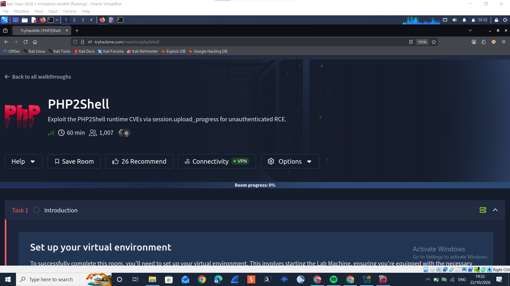
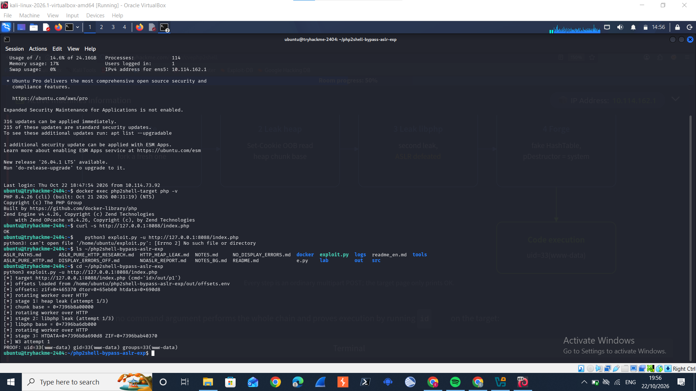
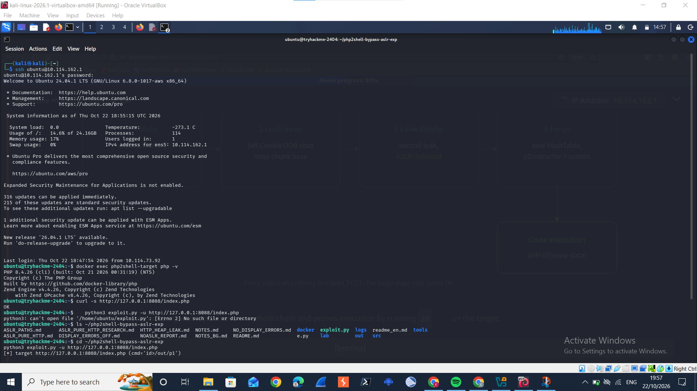
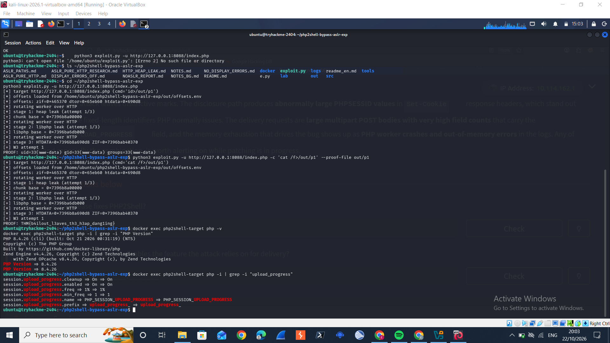
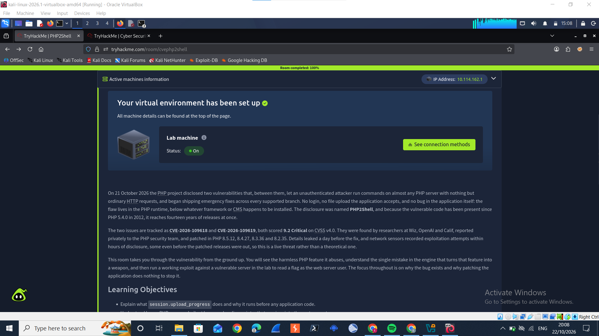

# PHP2Shell (TryHackMe) — Full Walkthrough & Writeup

> Exploiting PHP's `session.upload_progress` runtime bug (CVE-2026-109618 & CVE-2026-109619) for unauthenticated remote code execution — a beginner-friendly, step-by-step writeup.

**Room:** [tryhackme.com/room/cvephp2shell](https://tryhackme.com/room/cvephp2shell)
**Difficulty:** Hard concepts, guided execution — ~60 min
**Attacker view:** Unauthenticated, zero application vulnerabilities required
**Target:** PHP 8.4.26 (one patch release behind the fix)



---

## Table of Contents

1. [What This Room Is About](#what-this-room-is-about)
2. [Prerequisites & Lab Setup](#prerequisites--lab-setup)
3. [Connecting: VPN → SSH](#connecting-vpn--ssh)
4. [Task 2 — The Harmless Feature](#task-2--a-harmless-feature-upload-progress)
5. [Task 3 — The Bug](#task-3--the-bug-a-bailout-at-the-wrong-moment)
6. [Task 4 — Recon](#task-4--reconnaissance-confirming-the-target)
7. [Task 5 — Leaking Memory & Defeating ASLR](#task-5--leaking-memory-and-defeating-aslr-cve-2026-109618)
8. [Task 6 — From Leak to Shell](#task-6--from-a-leak-to-a-shell-cve-2026-109619)
9. [Mistakes I Made (and How I Fixed Them)](#mistakes-i-made-and-how-i-fixed-them)
10. [Task 7 — Detection, Mitigation & the Real Fix](#task-7--detection-mitigation-and-the-real-fix)
11. [Task 8 — Conclusion](#task-8--conclusion)
12. [Lessons Learned](#lessons-learned)
13. [How to Prevent This in Production](#how-to-prevent-this-in-production)
14. [Final Notes](#final-notes)

---

## What This Room Is About

On 21 October 2026, the PHP project disclosed two critical vulnerabilities that together let an **unauthenticated attacker run arbitrary commands on almost any PHP server** using nothing but ordinary HTTP requests — no login, no file upload the application itself accepts, and no bug in the application's own code.

The flaw lives in the **PHP runtime itself**, below whatever framework or CMS (WordPress, Laravel, etc.) happens to be installed. That's what makes it so dangerous: patching your application does nothing, because the application was never the problem.

| | |
|---|---|
| **Disclosure name** | PHP2Shell |
| **CVEs** | CVE-2026-109618 (memory disclosure) & CVE-2026-109619 (remote code execution) |
| **CVSS v4.0 score** | 9.2 Critical (both) |
| **Found by** | Researchers at Wiz, OpenAI, and Calif |
| **Affected since** | PHP 5.4.0 (2012) — 14 years of releases |
| **Fixed in** | PHP 8.5.12, 8.4.27, 8.3.36, 8.2.35 |

**Learning objectives of the room:**
- Understand what `session.upload_progress` does and why it runs *before* any application code
- Understand how a PHP memory bailout leaves a dangling pointer that survives into the next request
- Distinguish the two CVEs: a memory-disclosure path and a remote-code-execution path
- Run the public exploit chain to leak memory, defeat ASLR, and execute a command
- Learn to detect the attack and apply mitigations that actually work

---

## Prerequisites & Lab Setup

- A TryHackMe account with access to the room (Premium/Max — the room is subscriber-only)
- An attacking machine — I used **Kali Linux running in VirtualBox**
- TryHackMe's **OpenVPN** connectivity pack, or the in-browser AttackBox (I used my own Kali VM + VPN)

---

## Connecting: VPN → SSH

The room's "Connectivity" button shows a green **VPN** status once your OpenVPN connection to TryHackMe's network is active — this is what lets your Kali box reach the lab machine's private IP.

Once connected, the room gives you SSH credentials directly on the **Introduction** task:

```bash
ssh ubuntu@10.114.162.1
# password: tryhackme
```

> **Why SSH instead of the browser terminal?** The in-browser AttackBox terminal can be noticeably slow depending on your connection. Since the room gives you direct SSH access to the actual lab machine, SSHing in from your own terminal (Kali, in my case) is faster and lets you use your normal terminal workflow (tab-completion, scrollback, copy-paste).

Once connected, you land in the `ubuntu` user's home directory. The task description tells you everything you need is already there — the vulnerable server runs as a Docker container on the box itself, and the exploit code sits in the `ubuntu` user's home directory.

```
Welcome to Ubuntu 24.04.1 LTS (GNU/Linux 6.8.0-1017-aws x86_64)
```

---

## Task 2 — A Harmless Feature: Upload Progress

**Concept:** PHP has a built-in feature that lets a browser track the progress of a large file upload. While PHP is reading a `multipart/form-data` request body off the wire, it writes a running description of the upload (name, size, bytes received so far) into the user's `$_SESSION`. A second request can then read that session data and show progress to the user.

This feature is **on by default**. It activates for a given upload whenever the request includes a form field whose name matches the `session.upload_progress.name` setting.

**Question:** *What is the default name of the form field that switches on PHP's upload-progress tracking?*

**Answer:** `PHP_SESSION_UPLOAD_PROGRESS`

> **Why this matters:** This field name is the entire trigger for everything that follows. Any attacker — with no login, no account, nothing — can include this field name in an ordinary POST request and PHP will start doing session-progress work on their behalf.

**Key insight from this task:** the progress-tracking code runs **before any application code executes** — before `session_start()`, before routing, before anything. Parsing the request body is one of the very first things PHP does. That timing detail is the foundation the rest of the exploit chain is built on.

---

## Task 3 — The Bug: A Bailout at the Wrong Moment

**Concept:** The upload-progress feature itself isn't the vulnerability. The vulnerability is in *what happens when PHP runs out of memory while that feature is doing its work*.

PHP limits how much memory a single request can use via the `memory_limit` setting. If a request tries to exceed it, PHP can't just keep going — it performs what the engine internally calls a **bailout**: it uses a C-level `longjmp()` to immediately jump back to a safe recovery point, abandoning whatever it was doing. This is the mechanism behind the familiar "Allowed memory size exhausted" fatal error.

The flaw is a **timing bug**. If the out-of-memory condition hits *after* the engine has freed a block of memory but *before* it has cleared the pointer that referred to that block, the bailout skips the cleanup. The result is a classic **dangling pointer** — a pointer still pointing at memory that's no longer valid.

**Question 1:** *What one-word name does the PHP engine give to the longjmp it performs to abort a request that hits a fatal error (such as running out of memory)?*
**Answer:** `bailout`

**Question 2:** *What is the CWE identifier for the weakness class behind PHP2Shell?*
**Answer:** `CWE-824` (Access of Uninitialised Pointer)

> **Why this is dangerous:** Normally a dangling pointer in a request that just died would be harmless — the request is over. What makes it dangerous here is the **server model**. Under Apache's prefork configuration with `mod_php`, a single worker process serves one request after another *without restarting in between*. The stale pointer doesn't vanish with the failed request — it stays in the worker's memory, and the **next** request to land on that same worker finds the engine still reaching through a pointer that was never reset. Whoever controls what gets allocated into that freed space on the next request controls what the pointer now points at.

From this single defect, researchers built **two** distinct attacks (hence two CVEs):
- **CVE-2026-109618** — a *memory-disclosure* flaw: the stale pointer is read back as an oversized string, leaking memory contents to the attacker.
- **CVE-2026-109619** — the *remote-code-execution* flaw: the corrupted state is turned into full control over the program's execution flow.

---

## Task 4 — Reconnaissance: Confirming the Target

With SSH access as the `ubuntu` user, the first job is confirming exactly what's running before attacking it.

```bash
docker ps --format '{{.Names}}  {{.Image}}  {{.Status}}'
docker exec php2shell-target php -v
```

Output:
```
php2shell-target   php:8.4.26-apache   Up 3 minutes

PHP 8.4.26 (cli) (built: Oct 21 2026 00:31:19) (NTS)
Copyright (c) The PHP Group
Zend Engine v4.4.26, Copyright (c) Zend Technologies
```

```bash
curl -s http://127.0.0.1:8088/index.php
docker exec php2shell-target cat /var/www/html/index.php
```

Output:
```
OK
<?php echo "OK\n"; ?>
```

**Question 1:** *What version of PHP is the target server running?*
**Answer:** `8.4.26`

**Question 2:** *What single word does the target page at `/index.php` print in response?*
**Answer:** `OK`

> **Why this step matters:** The entire "application" is one line of code that prints `OK`. There is no login form, no file upload, no database — nothing to exploit in the application layer. This is the point the room wants you to internalise: **if the attack works against this trivial page, it works against the PHP runtime itself**, which means it works against WordPress, Laravel, or any other PHP app running underneath, regardless of how secure that application's own code is.

The exploit tooling is already present on the box:

```bash
ls ~/php2shell-bypass-aslr-exp
# ASLR_PATHS.md  docker  exploit.py  lab  logs  NOTES.md  out  README.md  readme_en.md  src  tools
```

---

## Task 5 — Leaking Memory and Defeating ASLR (CVE-2026-109618)

**Concept:** Modern systems load code and data at randomised memory addresses — a defence called **ASLR (Address Space Layout Randomisation)**. CVE-2026-109618 defeats this by turning the dangling pointer from Task 3 into a leak of the worker process's own memory.

Here's the mechanism, step by step:
1. An out-of-memory bailout is provoked while a session identifier is being handled, leaving a stale pointer to the session ID.
2. A following request reoccupies that freed memory space — and the attacker crafts the data so the **length field** associated with that pointer is inflated far beyond the real session ID's size.
3. When PHP sends the session cookie back to the client, it reads that corrupted (oversized) length and returns far more data than it should — reading straight past the real session ID into adjacent worker memory.
4. This leaked data comes back to the attacker in the **`Set-Cookie: PHPSESSID`** response header.

Research measured this leak at **up to ~67 KB of process memory per request**. In a real deployment that memory can hold other users' passwords, session cookies, API keys, and even TLS private keys. For this exploit, it's used to leak the two addresses needed to defeat ASLR:
- The **heap chunk base**
- The **`libphp` library base**

**Question:** *Which HTTP response header does CVE-2026-109618 abuse to return leaked process memory to the attacker?*
**Answer:** `Set-Cookie`

Running the exploit shows this leak happening live:

```bash
cd ~/php2shell-bypass-aslr-exp
python3 exploit.py -u http://127.0.0.1:8088/index.php
```



```
[*] stage 1: heap leak (attempt 1/3)
[+] chunk base = 0x7396b8a00000
[*] stage 2: libphp leak (attempt 1/3)
[+] libphp base = 0x7396ba6db000
```

> Each of those `[+]` lines is the result of a `Set-Cookie: PHPSESSID=...` header being read back by the exploit script and parsed for the leaked address. You don't see the raw HTTP header in the script's output because the tool extracts the values for you automatically — but that's exactly where the data came from.

---

## Task 6 — From a Leak to a Shell (CVE-2026-109619)

**Concept:** CVE-2026-109618 told the attacker *where* everything is in memory. CVE-2026-109619 turns that knowledge into **code execution**, by reoccupying the freed memory not with data to read, but with a carefully forged object that hijacks the engine's own cleanup machinery.

When PHP destroys a value, it may call a function pointer stored alongside it — a **destructor** — to release that value's resources. The exploit forges an internal structure (a `HashTable`) whose destructor pointer, `pDestructor`, has been set to the address of **`system()`** inside the PHP library — an address the Task 5 leak just revealed. When the engine tidies up at the end of request handling, it believes it's calling a harmless destructor. Instead it calls `system()` with attacker-controlled bytes as the argument.

**The full chain, in four requests:**
1. **Rotate** — crash a worker, fork a fresh one
2. **Leak heap** — `Set-Cookie` out-of-bounds read, get the heap chunk base
3. **Leak libphp** — second leak, defeats ASLR
4. **Forge** — fake `HashTable`, `pDestructor` → `system`

→ **Code execution**, running as `uid=33 (www-data)`

Every step is an ordinary multipart POST request to a page that only ever prints `OK`.

```bash
python3 exploit.py -u http://127.0.0.1:8088/index.php
```

```
[*] stage 3: HTDATA=0x7396b8a690d8 ZIF=0x7396bab40370
[+] W3 attempt 1
PROOF: uid=33(www-data) gid=33(www-data) groups=33(www-data)
```

**Question 1:** *When the exploit runs, which system user do the commands execute as?*
**Answer:** `www-data`

To retrieve the room's flag, the payload runs a command of your own choosing against the target:

```bash
python3 exploit.py -u http://127.0.0.1:8088/index.php -c 'cat /f>/out/p1' --proof-file out/p1
```

```
PROOF: THM{b4ilout_l3aves_th3_h3ap_dangling}
```

**Question 2:** *What is the flag returned by the exploit?*
**Answer:** *(redacted here — see note below)*

> 🚩 **Flag etiquette note:** I'm intentionally not publishing the literal flag value in this public writeup. TryHackMe flags are meant to be found by each learner themselves; posting the real value spoils the room for others. If a run ever stops short at the leak stage, just rerun the exploit — the memory corruption is probabilistic, and the tool automatically retries the fragile stages for you.

---

## Mistakes I Made (and How I Fixed Them)

Documenting the mistakes honestly, because this is exactly the kind of thing a beginner runs into:

### Mistake 1 — Running the exploit from the wrong directory

After SSHing in, I tried running the exploit script straight from my home directory:

```bash
ubuntu@tryhackme-2404:~$ python3 exploit.py -u http://127.0.0.1:8088/index.php
python3: can't open file '/home/ubuntu/exploit.py': [Errno 2] No such file or directory
```



**Why it happened:** `exploit.py` doesn't live in the home directory — it lives in a subfolder, `~/php2shell-bypass-aslr-exp`. Python needs to be told exactly where the script is, either by `cd`-ing into that folder first or by giving the full path.

**The fix:**
```bash
ls ~/php2shell-bypass-aslr-exp      # confirm the folder and its contents
cd ~/php2shell-bypass-aslr-exp      # move into it
python3 exploit.py -u http://127.0.0.1:8088/index.php
```

**Lesson:** `ls` before you run anything unfamiliar. If a script "can't open file," the very first thing to check is whether you're in the right directory, not whether the script itself is broken.

### Mistake 2 — Assuming every command needed the same `cd`

Later, when verifying the Task 7 mitigation directive, I second-guessed myself and asked whether I needed to `cd` again before running:

```bash
docker exec php2shell-target php -v
docker exec php2shell-target php -i | grep -i "upload_progress"
```

**Why this wasn't actually a problem:** `docker exec` doesn't care about your shell's current working directory — it just tells the Docker daemon "run this command inside this named container." Only direct script execution (like `python3 exploit.py`) is sensitive to your current directory, because Python has to locate the file on disk relative to where you are.

**Lesson:** not all commands have the same "where am I" sensitivity. Commands that reference a container, a service, or a remote resource by *name* (like `docker exec <container-name>`) don't care about your local directory. Commands that reference a *file* by relative path do.

---

## Task 7 — Detection, Mitigation and the Real Fix

**Concept:** Because PHP2Shell lives in the runtime, the instinct to "update the website" completely misses it. Updating WordPress, Drupal, Joomla, or Laravel changes the *application*; the vulnerable code sits in **PHP itself**, underneath all of them. The only complete fix is patching the PHP runtime — updating to **8.5.12, 8.4.27, 8.3.36, or 8.2.35** — and restarting every worker so no process keeps running the old code in memory.

**Interim mitigations** (none are a substitute for patching):
- Disable the feature the attack relies on: `session.upload_progress.enabled = 0`
- Turn off the opcode cache: `opcache.enable = 0`
- Reduce crash verbosity: `fatal_error_backtraces = 0` (addresses CVE-2026-109619 specifically)
- At the network edge, reject `multipart/form-data` requests (blocks delivery, at the cost of breaking legitimate uploads)
- Run the PHP process with least privilege

> **A defence that does *not* help:** a web application firewall (WAF) running as a PHP module inspects traffic only *after* PHP hands control to the application — but this attack does its damage while the request is still being parsed, before the application ever runs. Protection has to sit either in the patched runtime itself, or at a layer in front of PHP (not inside it).

**Detection signatures** worth alerting on:
- Abnormally large `PHPSESSID` values in `Set-Cookie` response headers
- Large multipart POST bodies with very high field counts carrying the `PHP_SESSION_UPLOAD_PROGRESS` field
- PHP worker crashes and out-of-memory errors in the logs

I verified both the trigger and the mitigation **live on the target** rather than just trusting the task text:

```bash
docker exec php2shell-target php -v
docker exec php2shell-target php -i | grep -i "PHP Version"
docker exec php2shell-target php -i | grep -i "upload_progress"
```



```
PHP Version => 8.4.26

session.upload_progress.cleanup   => On
session.upload_progress.enabled   => On
session.upload_progress.freq      => 1%
session.upload_progress.min_freq  => 1
session.upload_progress.name      => PHP_SESSION_UPLOAD_PROGRESS
session.upload_progress.prefix    => upload_progress_
```

This confirms two things from the live system, not just the room's prose:
- `session.upload_progress.name` really is set to the default `PHP_SESSION_UPLOAD_PROGRESS` (Task 2's answer)
- `session.upload_progress.enabled` is currently `On` — exactly why the whole attack chain works on this box, and exactly what you'd flip to `0` as an interim mitigation

**Question 1:** *Which PHP 8.4 release fixes PHP2Shell?*
**Answer:** `8.4.27`

**Question 2:** *Which `php.ini` directive, set to 0, disables the feature the attack relies on for delivery?*
**Answer:** `session.upload_progress.enabled`

---

## Task 8 — Conclusion



PHP2Shell is a reminder that the software stack doesn't stop at the application. A single mistake in how the PHP engine recovers from running out of memory — present and unnoticed since 2012 — exposed an unauthenticated path to code execution on a huge share of the web's PHP-powered servers, independent of which framework or CMS sat on top.

The lesson for defenders: **treat the runtime as part of the attack surface**, and patch it with the same urgency as the application. A flaw this deep cannot be reached by securing the layers above it.

---

## Lessons Learned

1. **The application layer isn't the whole attack surface.** This entire exploit chain worked against a one-line PHP file that does nothing but print `OK`. No WordPress plugin, no custom code, no SQL injection — the vulnerability was entirely below the application, in the language runtime itself.

2. **Timing bugs are a real, exploitable bug class.** A dangling pointer caused by a cleanup step being skipped during an emergency abort (`bailout`) isn't just a crash — under the right server model (prefork workers reused across requests), it becomes a foothold for memory disclosure and then code execution.

3. **ASLR is a mitigation, not a fix.** CVE-2026-109618 shows that if an attacker can get a reliable memory-disclosure primitive, ASLR can be defeated by simply reading the addresses it was supposed to hide.

4. **"Update your CMS" isn't always the right advice.** For a runtime-level bug like this, the fix has to happen at the PHP version / language-runtime level — updating the application framework running on top of it does nothing.

5. **A WAF is not a universal safety net.** If a vulnerability triggers *before* your protective layer gets a chance to inspect the request (as this one does, during body-parsing), that layer can't help you. Defence has to sit at the right point in the request lifecycle.

6. **Check your working directory before blaming the tool.** My own `exploit.py` mistake above is a perfect example — the error looked like it might be a broken script, but it was simply a `cd` I forgot.

7. **Verify claims against the live system when you can.** Rather than trusting the room's task text for Task 7's answers, running `php -i | grep` against the actual target confirmed the exact directive names and their live values — a much better habit than taking documentation at face value.

---

## How to Prevent This in Production

If you run PHP in production, here's the actionable checklist this room points to:

- [ ] **Patch PHP** to 8.5.12 / 8.4.27 / 8.3.36 / 8.2.35 (or later) and restart every worker process afterward
- [ ] If you can't patch immediately, set `session.upload_progress.enabled = 0` in `php.ini`
- [ ] Set `opcache.enable = 0` as an interim measure if the opcode cache isn't critical for your workload
- [ ] Set `fatal_error_backtraces = 0`
- [ ] At your reverse proxy / edge, consider rejecting `multipart/form-data` requests if your application doesn't need file uploads
- [ ] Run PHP-FPM / Apache workers with the least privilege necessary
- [ ] Monitor for abnormally large `Set-Cookie: PHPSESSID` values and for PHP worker crashes / OOM errors in logs
- [ ] Don't rely on a PHP-module WAF alone for this class of bug — it inspects traffic too late in the request lifecycle

---

## Final Notes

This was a genuinely eye-opening room — it's one thing to know in the abstract that "the runtime matters," and another to watch a completely empty, one-line PHP application get fully compromised through nothing but crafted HTTP requests. Recommended for anyone working toward a Blue Team / defensive security specialisation, since the detection and mitigation sections (Task 7) are just as valuable as the exploit chain itself.

**Room link:** [tryhackme.com/room/cvephp2shell](https://tryhackme.com/room/cvephp2shell)

---

*Writeup by Edidong Etuk
